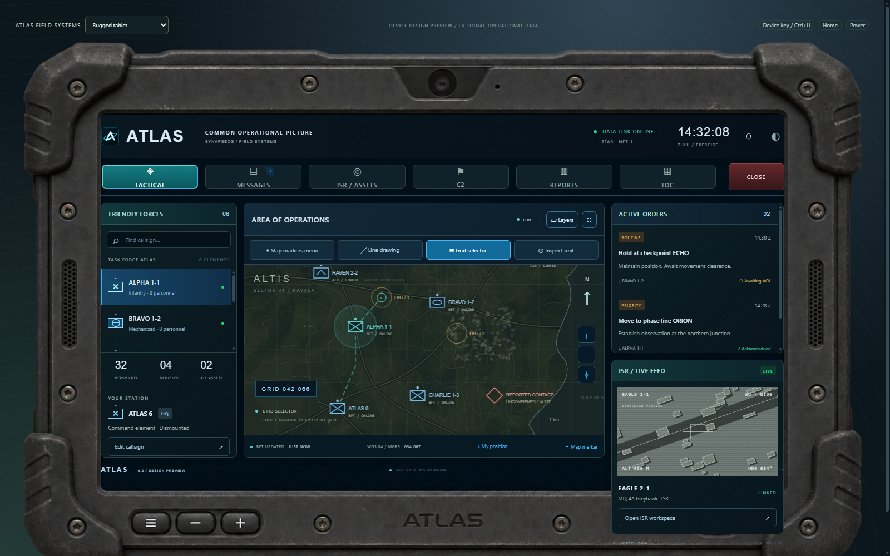
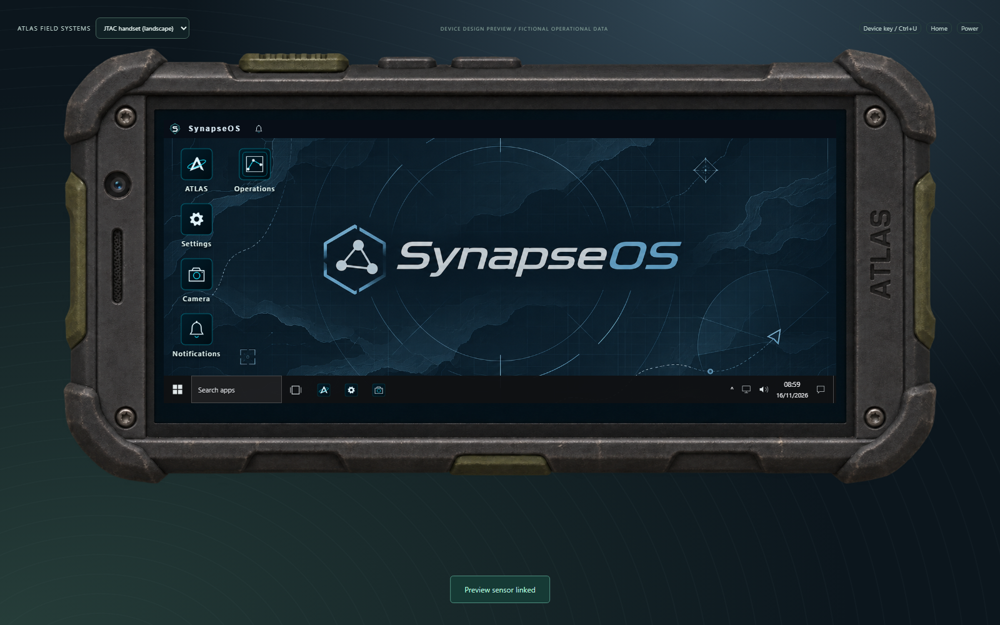
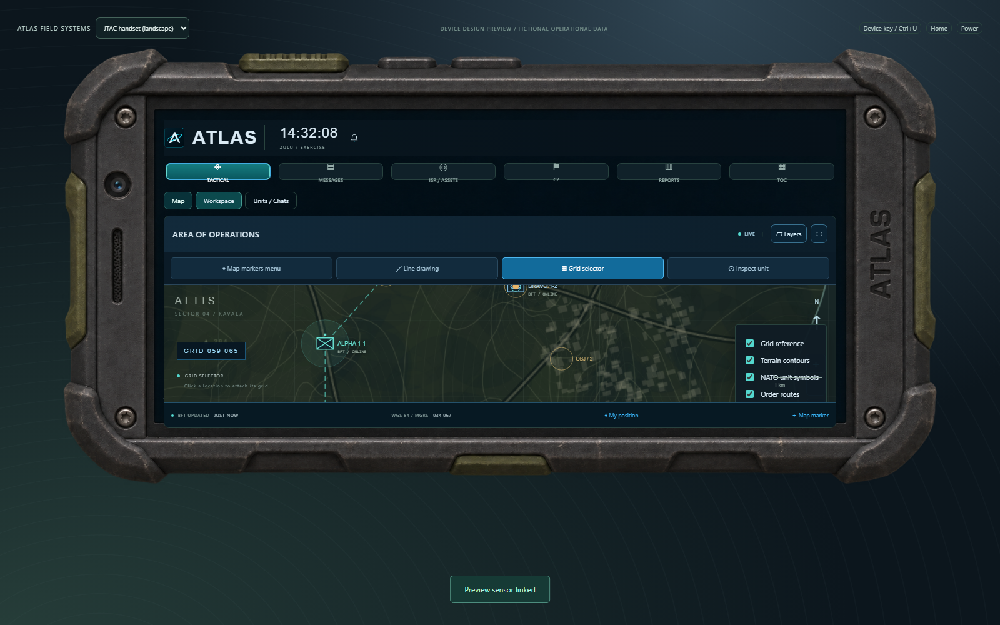
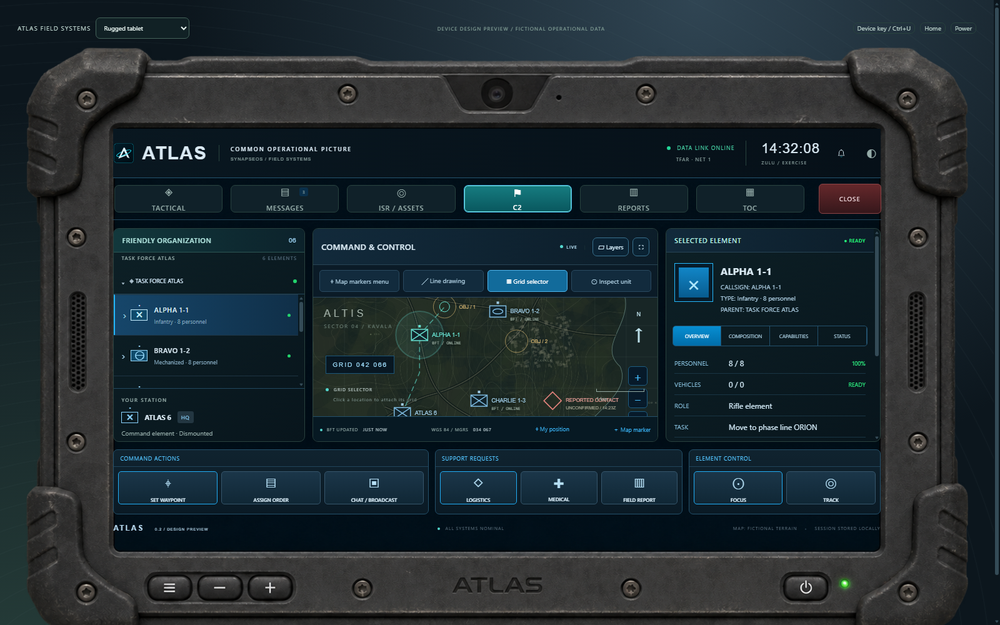
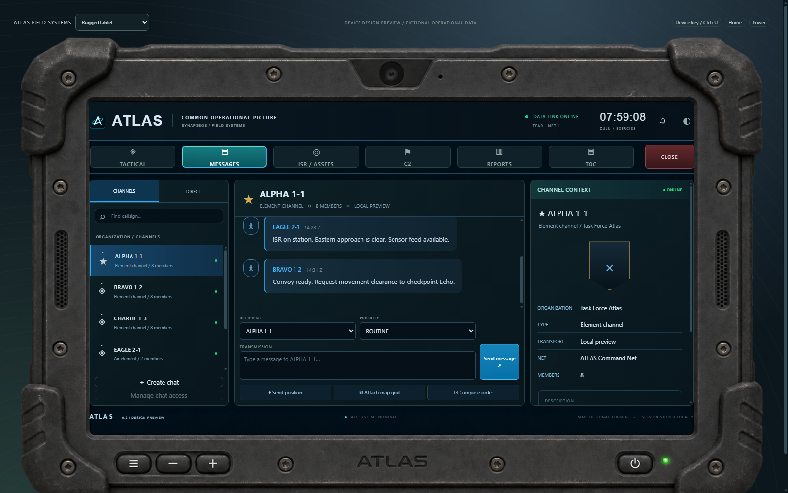
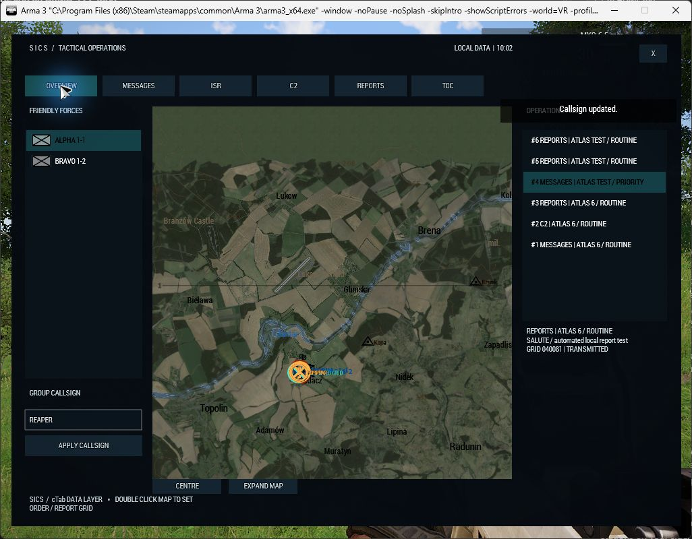

# SynapseOS — Modular Tactical Platform

SynapseOS is a modular device platform for Arma 3. Its first tactical application, ATLAS, provides BFT, messaging, ISR access, orders, reporting, callsigns and mission-defined TOC terminals. This project contains editable source, release artifacts and an interactive design preview.

The interface separates **Field User** tasks and personal settings from **Mission Setup** in Eden and live **Command Element** workflows in Operations. See the [usability model](docs/USABILITY-MODEL.md) for the roles, setup sequence and permission boundaries.

The project folder is `SynapseOS`. ATLAS remains the battlefield-management app; existing `SICS_fnc_*` / `ATLAS_fnc_*` APIs, addon paths and inventory class IDs retain compatibility. Previously frozen beta archives keep their original names and binary checksums. See [project naming](docs/PROJECT-NAMING.md).

**0.12.0-beta.3 candidate:** cTab-free addon source and PBO, with SynapseOS-owned devices, BFT snapshots, marker rendering, vehicle-seat rules, aviation routing and ISR camera lifecycle. Requires Arma 3 + CBA_A3; ACE is optional. This candidate has compiled, but has not passed a clean Arma launch or in-game smoke run. Do not treat it as a public release yet. See the [release workup](docs/PRODUCT-WORKUP.md).

**v0.8: ATLAS on SynapseOS.** A device launcher with an ATLAS application icon, a single-key moving GPS/full-device workflow, saved app sessions, realistic rugged hardware, a horizontal JTAC handset on foot, and large mounted vehicle/aircraft consoles. Includes custom chats, structured map reports, notifications, live friendly tracking and the unit inspector.

**v0.8.1:** separate ATLAS Tablet and ATLAS Phone arsenal items, optional ACE self-interaction device selection, and remembered personal-device preference.

**v0.12.0-beta.3 candidate:** SynapseOS-owned device classes, BFT snapshots, map symbology, vehicle access policy, aviation display routing and ISR camera lifecycle. Requires Arma 3 and CBA_A3; no cTab runtime dependency. See `docs/PRODUCT-WORKUP.md` for the remaining no-cTab in-game acceptance gate.

**Status:** independent candidate in development. The older frozen 0.12.0-beta.2 build passed 681 native checks and 20 isolated dedicated-backend checks while cTab was installed; those results do not validate this new runtime. Clean Arma startup, no-cTab functional checks, real-client multiplayer/JIP, competing operators, third-party radio sessions and extension-policy compatibility remain release gates. Historical beta instructions are labeled in the docs.







New C2 and Messages design previews:





Previously verified v0.1 native Arma overview after the blank-display fix:




## SynapseOS device usage

The moving GPS is noninteractive, keeping movement and vehicle controls available. Home returns to the desktop, − minimizes, and × powers off. Escape closes the interactive display. Normal close retains the app session; power-off resets the next opening to Home.

| Control | Default | Action |
| --- | --- | --- |
| Toggle Main | U | Show/hide moving GPS; minimize the full device |
| Toggle Secondary | Ctrl+U | Show/hide the full device or mounted console |
| Toggle Tertiary | Alt+U | Open carried equipment, preferring Tablet; mounted fallback if none is carried |
| Zoom In / Out | Ctrl+Shift+Page Up / Page Down | Change overlay or visible tactical-map scale |
| Toggle Interface Position | Ctrl+Shift+Home | Swap overlay sides; reset full device to centre |

In enabled helicopter/aircraft seats, Main and Secondary use SynapseOS's aviation display and BFT symbology. Tertiary returns to carried equipment. ATLAS uses configurable CBA keybinds; minimize buttons and the legacy cycle function remain available.

In **ISR**, choose an authorised active drone, then **Pilot**, **Turret / weapons**, or **UAV terminal**. A compatible UAV terminal is required; native Arma ownership and occupied-seat checks apply. Turret control uses weapons fitted to the selected vehicle. Select a listed helmet camera to watch its feed. Streams close when leaving the app or device.

Open **Settings** to change personal callsign, role and display rank. Accepted profiles are saved locally per UID and published by the server. Save a stored profile again to apply it to a new mission/player object. Group callsign has a separate leader-only control. Display rank does not change Arma rank, leadership or commander permissions.

On foot, `ATLAS_Phone`, `ATLAS_MicroDAGR`, or `ATLAS_Tablet` opens the matching SynapseOS layout. Enabled ground-vehicle seats open a large console; pilot/copilot seats open the aviation console. SynapseOS applies its own vehicle-class and seat rules; mission makers can override allowed classes. Rear passengers need their own personal device. Exiting a mounted console closes it; the next opening resolves the new context. TOC terminals use a large workstation.

ATLAS retains selected unit, map position/zoom, current application tab and chat, message/report composer text, and suspended contact/channel forms within the current mission and side. Cancelling a form discards that form's draft. Normal server audience checks still apply when restoring chats. Complex forms use an expanded workspace for readable inputs on handhelds.

SynapseOS is the device shell, with ATLAS, Settings and Camera applications. Desktop shortcuts, a Start menu and taskbar use the supplied custom wallpaper within the hardware's glass bounds. Every app, including registered future apps, receives the same cyan rounded icon frame; supply a transparent central glyph. Existing `SICS_fnc_*` API names and transport identifiers remain compatibility aliases. New mission code can use `ATLAS_fnc_*` and `ATLAS_commander`; legacy commander flags remain supported.

```

Apps receive the display and current device mode. Use control IDs ≥2000, keep Home/Minimize/Power controls intact, and retain app-specific data independently of its controls. The launcher paginates eight apps per page. Registration accepts trusted local SQF code, never network-supplied script strings. No placeholder extra tools are shipped. `[] call Synapse_fnc_open` opens the full device launcher/resumed app; `["ATLAS"] call Synapse_fnc_launchApp` launches ATLAS in an already open device.

## Custom chat channels

In **Messages**, use **Create chat** to name a channel and choose Command, Ground to Air, or Custom. Select players, groups and optional managers in the three access lists; **Ctrl+click** selects multiple entries. The creator always owns and can access the channel. Managers can read the chat and edit its membership. Granting an individual OR their group gives access. **Manage chat access** edits the selected channel's name, type and access lists.

Owners and managers can also use **Delete channel** in that editor, then **Confirm delete** after reviewing the channel name. Deletion removes the channel and its retained history from the server, purges members' cached conversations, and notifies affected members. It cannot erase screenshots or information already read.

Creation requires mission-designated commander access. Mission makers can assign it to a unit with `_unit setVariable ["ATLAS_commander",true,true];`. Grant it again on a respawned unit if your mission replaces that object. Ordinary group leadership alone does not grant channel creation. Channel owners and managers can maintain their existing channels without this creation privilege.

Select a custom channel in the left sidebar or recipient dropdown to read and send. Other channels and broadcasts are not mixed into its history. Unread counts are per channel. Channel types are organisational labels; they do not automatically add pilots, route radio audio or filter by TFAR/ACRE frequency.

The server checks membership for sending, delivery and history replay. Personal grants use player UID and survive respawn/reconnect in the same mission; select online players when adding new personal grants. Existing offline grants remain editable. Group grants follow the current group object and do not transfer to a newly created group just because its callsign matches. Membership is reconciled every two seconds; removing access purges that client's cached channel history on the next sync. Previously read information cannot be made unknown. Opposing sides cannot join even with an individual grant.

Channels and messages persist only for the current mission. Up to 64 channels, with up to 64 entries in each access list, are supported. The existing shared retention limit is the latest 300 records across messages, orders and reports. These channels do not add disk persistence or cryptographic encryption.

## Contact reports, alerts and movement

The map toolbar also has **Inspect unit**. Click a friendly symbol to open a live read-only inspector showing callsign/unit name, selected person's or vehicle's name, current grid, status, combat state, and a scrollable list of team members with ranks and individual statuses. Selection survives map panning and works with Centre selected. Clicking empty terrain retains the selected unit and does not change the transmission grid. Status distinguishes ready, moving, wounded, incapacitated and killed. Combat means the team's engine-reported `COMBAT` behaviour; it cannot reliably infer a human player's combat intent or every firefight. Hover over the summary for this explanation.

In Reports, choose **Mark contact on map**, then click the observation location. The position-report menu asks for **Designation**, **Strength / contact count**, **Affiliation / colour**, **Marker type**, the installed NATO symbol, and optional activity notes. Designation allows 1–48 characters; strength is a whole number from 1–9999. Infantry, motorized, armoured, helicopter, fixed-wing and artillery types select a matching NATO symbol where available; the full installed symbol picker remains editable. The shared marker label includes designation, affiliation, type and count (for example `ENY ARMOUR 01 / OPFOR / Armoured vehicle x2`). These fields also remain in the report record and replay. BLUFOR is blue, OPFOR red, UNKNOWN yellow, INDEPENDENT green and CIVILIAN purple. The catalogue reads the loaded Arma `CfgMarkers`, including compatible mod additions. Arma supplies b_/o_/n_ symbol families; unknown and civilian use neutral frames with their explicit colour. This is the installed Arma catalogue, not a complete independent APP-6 implementation. Contacts remain at their reported position and time.

Incoming messages, reports, orders and order acknowledgements produce an app notification. Unread badges clear when the corresponding tab opens. Own transmissions, repeated records and replayed history do not create fresh alerts.

Incoming notifications include a visual banner and a local spoken cue: new message, report, contact report, order, acknowledgement, channel update or general information. Channel access changes/deletion and server notices also receive feedback. Speech is queued to avoid overlapping voices and uses the game's audio volume. Bundled English voice clips are generated by `tools/create-notification-audio.ps1` using Windows speech synthesis. Routine outgoing transmission confirmations and replayed history remain quiet. The offline browser preview plays equivalent clips when browser autoplay policy permits; this limitation does not apply to native Arma playback.

Friendly equipped dismounted units and crewed vehicles are sampled by SynapseOS and update with position, heading, speed and aircraft altitude. This does not discover enemy vehicles. In **Grid selector** mode click a friendly map symbol, pan away, then use **Centre selected** to return to its current position. **My position** centres your own unit separately.

The supplied PBO is unsigned. A server enforcing signatures needs the server owner's signing process; no private key is supplied.

## In-game controls

- Click a roster entry to centre the map on it; use the map's standard drag and wheel controls.
- **Map markers menu:** opens the symbol/colour/label menu immediately. Choose **Place on map**, then click the desired position. With Markers active, clicking a location also opens the editor directly; click near an existing ATLAS icon to edit it. Its creator or a mission-assigned commander can change or delete it. Sizes range from 0.25 to 3; labels allow 100 characters.
- **Line drawing:** click a start point, then an end point. A live dashed preview follows the cursor between clicks. Right-click cancels an unfinished line or deletes a nearby line you are authorised to remove. Lines are native Arma polyline markers, shared with your side.
- **Grid selector:** click a location to select its grid without opening a marker dialog. The selection is attached to your next message, order or report. Dragging still pans the map.
- ATLAS markers are side-shared and created as native Arma markers on authorised clients, so they also appear on the ordinary map. Existing Arma/mission markers remain visible but are not edited by this tool. Up to 200 ATLAS markers are kept in server memory, independently of the 300-record communications history. Reopening ATLAS synchronises the current marker set; a mission restart clears it.
- **Messages:** choose All stations or a friendly element, read the chronological conversation, and type in the bottom composer. Enter sends; Shift+Enter adds a new line. Your draft clears after server acceptance. Broadcasts also appear in element conversations; private group-targeted messages remain server-filtered. This is a C2 chat design inspired by the requested workflow, not a claimed reproduction of a proprietary ELIAS specification.
- C2 / Reports: choose priority and recipient, enter text, then transmit. Empty recipient means all stations on your side.
- Only group leaders or units with `ATLAS_commander = true` may issue orders. Recipients can acknowledge selected C2 records. Acknowledgements identify groups.
- Only the group leader may change its global callsign. SynapseOS updates the shared track label from the group ID.
- ISR: select an authorised friendly UAV or ATLAS helmet-camera source for a SynapseOS camera feed. Use “Link UAV terminal” for the engine's sensor and turret controls. A compatible assigned UAV terminal is needed for native linking; engine occupancy and permissions apply. Picture-in-picture must be enabled for embedded video.

## Mission makers: TOC room

Place desks, laptops or screens in your command room. Put this in each terminal object's Eden init field (executed for every machine including joining clients):

```sqf
[this, west, "TOC ATLAS"] call ATLAS_fnc_registerTOC;
```

The function registers an action locally on each client, and broadcasts the terminal's authorised side from the server. An alive player on that side within **5 metres** can open ATLAS without a personal device. Moving out of range closes access unless the player carries a supported device. The terminal object must have a persistent network identity; placed Eden objects are suitable.

Optional commander role, in a unit's init:

```sqf
this setVariable ["ATLAS_commander", true, true];
```

Example group callsign:

```sqf
group this setGroupIdGlobal ["ATLAS 6"];
```

See `examples/mission-setup.sqf`. The browser TOC workspace also exports an Eden init snippet.

## Radio compatibility

TFAR and ACRE2 are optional. Their public APIs populate a radio-possession status in the header. ATLAS messages use Arma's network transport, not TeamSpeak audio or a simulated RF link. There is currently no frequency filtering, terrain attenuation, retransmission, radio-range gating or loss simulation. Without either radio mod the header reads `LOCAL DATA`.

## Data and security model

The production addon uses SynapseOS-owned gear checks, BFT snapshots, marker rendering, vehicle-access policy, aviation display routing and ISR camera lifecycle. It does not load cTab classes, assets, functions or runtime globals. The actual camera feed and no-cTab mission path still require in-game acceptance on the target Arma build.

ATLAS transmissions are an independent server-authoritative service. Every request validates the remote owner's player object, device or terminal access, payload types and lengths, recipient side and command permissions. Records are compartmentalised by **Arma side**, and targeted messages are delivered only to the target group and original sender. The server keeps the latest 300 records in memory, replays permitted records when a client opens ATLAS, and discards them on mission restart. Text is displayed as plain text. BFT eligibility and delivery use SynapseOS policy; radio range and TFAR/ACRE encryption are not simulated.

If your mission has a restrictive `CfgRemoteExec`, merge the entries in `examples/CfgRemoteExec.hpp` into it. The receive function allows hosted-server player execution and rejects any sender other than server owner 2 at runtime. ATLAS never invokes remote script compilation.

## Preview and build

Open `preview/index.html` in Edge or Chrome. It works directly from disk without npm dependencies or internet fonts. Preview state is local to the browser; the map and sensor feed are fictional. It is not connected to a running game.

```powershell
hemtt check
hemtt build --no-bin
node tools/check-preview.mjs
powershell -ExecutionPolicy Bypass -File tools/package.ps1
```

HEMTT rapifies the config and compiles/checks SQF before writing the PBO. No Arma Tools binarisation is needed for this script-only addon. `tools/package.ps1` now creates a versioned candidate with a signed PBO, public key, source archive and checksums; it does not publish or upload anything. The UI check uses installed Microsoft Edge headless; set `ATLAS_BROWSER` to another Chromium executable if needed. It creates a disposable temporary browser profile and never opens your personal profile.

## Verification still required in Arma

Use `docs/IN-GAME-TESTS.md` before a public server release. `powershell -ExecutionPolicy Bypass -File tools/launch-test.ps1` launches the local CBA-only harness full-screen; use `-Windowed` to test in a window. Start Steam first. Dedicated-server ownership validation, hosted sessions, side isolation, target filtering, JIP replay, respawn, terminal distance, varying UI scales, UAV camera availability and TFAR/ACRE2 combinations still need acceptance testing. The older passing smoke results belong to the cTab-dependent beta 2 build and do not establish standalone runtime correctness.

API references: [Bohemia CfgFunctions](https://community.bohemia.net/wiki/CfgFunctions), [ACRE2 functions](https://acre2.idi-systems.com/wiki/frameworks/functions-list), [TFAR repository](https://github.com/michail-nikolaev/task-force-arma-3-radio).


## Branch workflow

Development and beta testing go to dev. Keep main for reviewed releases and mod updates; promote a validated dev build through a pull request. See [docs/DEVELOPMENT-WORKFLOW.md](docs/DEVELOPMENT-WORKFLOW.md).
